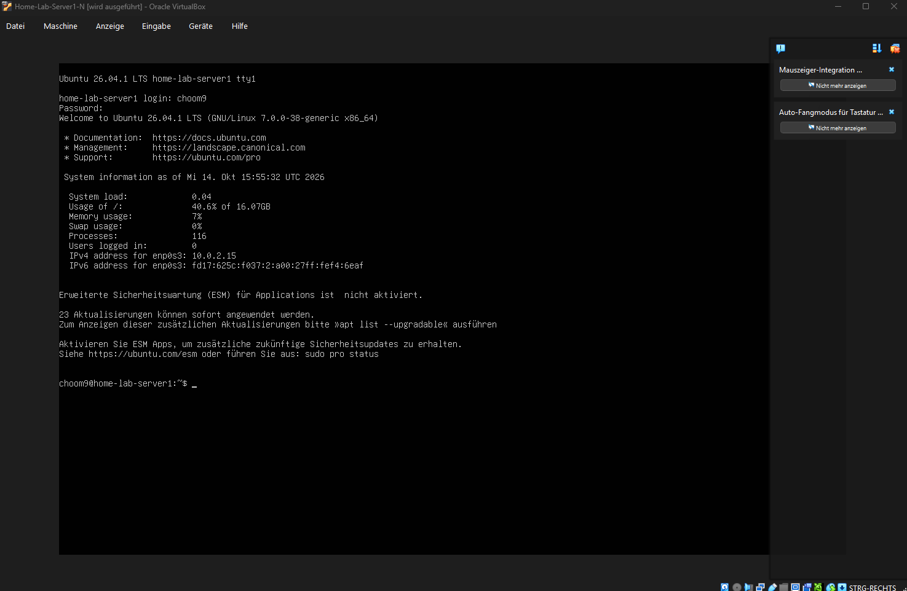
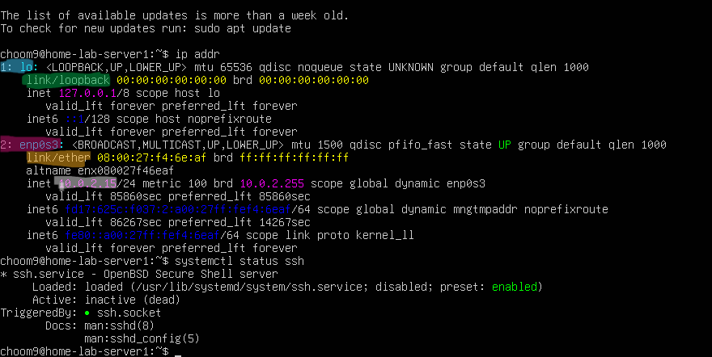

# Home-Lab

Also... ich kenne mich noch nicht so gut aus mit Servern, wie sie miteinander interagieren, wie man sie sichert und wie man sie bedient. Dieses Home-Lab soll mir als Einstieg in diesen Teilbereich der Informatik dienen. Im Repo werde ich dokumentieren was ich mache. Außerdem erkläre ich für mich Konzepte und Vorgänge. 

## Der Plan 

Zusammen mit einem LLM habe ich einen Plan für ein Home-Lab erstellt (auf Basis von menschlichen Empfehlungen), der wie folgt aussieht:

1. Virtuellen Server aufsetzen:
   - Ubuntu Server als virtuelle Maschine mit VirtualBox erstellen
   - System aktualisieren und überprüfen ob der Server korrekt läuft

2. Remote-Zugriff einrichten:
   - IP-Adresse des Servers herausfinden
   - Von Windows per SSH auf den Server zugreifen
   - Grundlegende Linux-Befehle zur Serververwaltung kennenlernen

3. Netzwerk verstehen:
   - IP-Adresse, Subnetz, Gateway und DNS untersuchen
   - Verstehen, wie Ports und Netzwerkdienste funktionieren
   - Überprüfen, welche Dienste auf dem Server erreichbar sind

4. Server absichern:
   - SSH-Key-Authentifizierung einrichten
   - Unnötige SSH-Zugriffsmöglichkeiten deaktivieren
   - Benutzer und Berechtigungen kennenlernen
   - Firewall einrichten und nur notwendige Verbindungen erlauben

5. Docker einrichten:
   - Docker und Docker Compose installieren
   - Images, Container, Ports und Volumes kennenlernen
   - Einen ersten Dienst als Container betreiben.

6. Monitoring einrichten:
   - Uptime Kuma mit Docker Compose betreiben
   - Überwachen, ob Dienste erreichbar sind
   - Logs und Linux-Werkzeuge verwenden, um den Zustand des Servers zu untersuchen

7. Backup und Wiederherstellung einrichten
   - Einen einfachen Backup-Prozess erstellen
   - Backups automatisieren
   - Testdaten löschen und aus einem Backup wiederherstellen

8. Troubleshooting üben:
   - Einen Dienst absichtlich stoppen oder falsch konfigurieren
   - Den Fehler mithilfe von Logs, Netzwerk- und Docker-Werkzeugen untersuchen
   - Ursache finden, Problem beheben und Lösungsweg dokumentieren.

## Dokumentation der Ausführung des Plans

### Schritt 1: Aufsetzung des virtuellen Servers

Ich habe einen virtuellen Server aufgesetzt und darauf Linux installiert. Ich habe keinen extra Computer den ich für das Home-Lab opfern kann, deswegen die Verwendung einer "virtuellen Maschine". 
Um es in meinen Worten zusammenzufassen: Ich habe einen Computer in meinem Computer geöffnet und darauf ein Linux Betriebssystem ohne UI installiert. So wie ich das verstanden habe, ist ein Server im Grunde ein Computer, der die Berechnungen für einen anderen Computer (Client) ausführt. Mein PC hat 16 CPU Kerne, 32 GB RAM und momentan 140GB freien SSD Speicherplatz. Der virtuellen Maschine habe ich 2 Kerne, 4GB RAM und 35GB Speicher verwiesen. Die empfohlenen Mindestanforderungen für einen Server laut Ubuntu sind 3GB RAM und 25GB Speicher. Virtueller Server und mein Computer laufen gleichzeitig, also sollte ich auf keinen Fall die ganze Rechenpower meines PCs verwenden.

### Schritt 2: Remote Zugriff einrichten

Bei diesem Step sorge ich dafür, dass ich meinen Server auch von meinem PC aus steuern und verwalten kann. Dafür brauche ich den Dienst SSH (Secure Shell). SSH ist ein Verfahren mit dem man sich verschlüsselt über ein Netzwerk auf einem andern Rechner anmelden und diesen über die Kommandozeile steuern kann. Damit das funktioniert muss meine VM ein Programm haben, dass SSH Verbindungen annehmen kann (wurde bei meinem Home-Lab schon während der Ubuntu Installation gemacht), und mein PC ein Programm haben, dass SSH Verbindungen starten kann. Ok... Ich starte meinen Server und melde mich an. Jetzt muss ich erstmal die IP Adresse meiner VM herausfinden. Das geht mit dem Befehl: "ip addr". 

Das ist ein Bild der Ausgabe nach dem Befehl. Ich habe für mich 5 wichtige Dinge markiert und versuche sie zu erklären:
blau: "lo:" -> Steht für loopback -> Ist für die Kommunikation innerhalb des Computers. Wenn ein Programm mit einem anderen innerhalb der VM kommuniziert braucht es loopback Angaben
grün: "link/loopback" -> Die folgende Schnittstelle ist vom Typ Loopback
lila: "enp0s3" -> en = Ethernet, p0 = Bus/Pfad Position (eigentlich gemeint für PCI Bus bei Hardware, VM simuliert aber die Struktur), s3 = Slot Position; Die Netzwerkschnittstelle meiner VM mit der sie mit anderen Systemen kommunizieren kann
orange: "link/ether" -> Die folgende Schnittstelle ist vom Typ Loopback
weiss: "10.0.2.15" -> Die IPv4-Adresse meiner VM an der Netzwerkschnittstelle enp0s3; DIE BRAUCHE ICH
